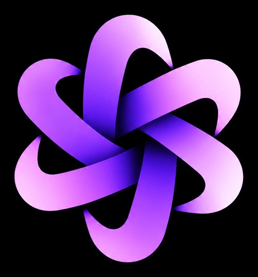

<p align="center"></p>

# Secrets

**Your world. Your people. Your space.**

The Secrets web client: chats, Docks, calls, stories and the Grace assistant, dark-first, for mobile
and desktop. This repository is **frontend only**. It runs against a built-in mock API, so there is
no server, database or account to set up.

## Stack

React 18, Vite, Tailwind, Zustand, React Router. Tests use Vitest and Testing Library; linting uses
ESLint (flat config). Shared wire types are imported through the `@shared` alias.

## Run it

```bash
pnpm install
pnpm dev          # http://localhost:5173, mock API on by default
```

Sign in with the demo account **ava / secrets123**, or tap "Continue with Google" and pick a demo
account, or create a new account from the Welcome screen. Mock data lives in `localStorage`; clear
site data to start fresh.

To point at a real API later, copy `.env.example` to `.env.local` and set `VITE_USE_MOCKS=false` plus the service URLs.

## Scripts

| Command | What it does |
|---|---|
| `pnpm dev` | Dev server with hot reload |
| `pnpm build` | Typecheck and production build to `dist/` |
| `pnpm typecheck` | `tsc --noEmit` |
| `pnpm lint` | ESLint over `src/` |
| `pnpm test` | Vitest (jsdom) |
| `pnpm check` | Typecheck, lint, test and build |

## Layout

| Path | What |
|---|---|
| `src/routes` | Screens: auth/onboarding, chats, docks, calls, ai (Grace), profile, settings, What's new, workspace (notes, tasks, vault, moments) |
| `src/ui` | UI kit (buttons, inputs, sheets, coachmarks, blueprint primitives in `bp.tsx`) |
| `src/styles` | Design tokens (`tokens.css`, `bp.css`) for System, Light, Dark and Black themes |
| `src/stores` | Zustand stores (session, settings, chat, ui, toast) |
| `src/api/mock` | Mock API: router, seeded database, features (stories, notes, tasks, vault) |
| `src/shared` | Wire contracts (REST, realtime, AI, voice) |
| `src/lib` | API client, theme, flags, helpers |
| `assets`, `public` | Logo, mascot and overview mockup, used as-is |
| `docs` | Blueprint checklist and notes |

## Design source

Every screen follows the Secrets blueprint. [docs/BLUEPRINT-CHECKLIST.md](docs/BLUEPRINT-CHECKLIST.md)
maps each blueprint page to its route and component, and
[docs/BLUEPRINT-NOTES.md](docs/BLUEPRINT-NOTES.md) records every assumption where the blueprint is
silent.

## Security

See [SECURITY.md](SECURITY.md). The mock API is for development and demos only; it stores data in the
browser and does no real authentication.
